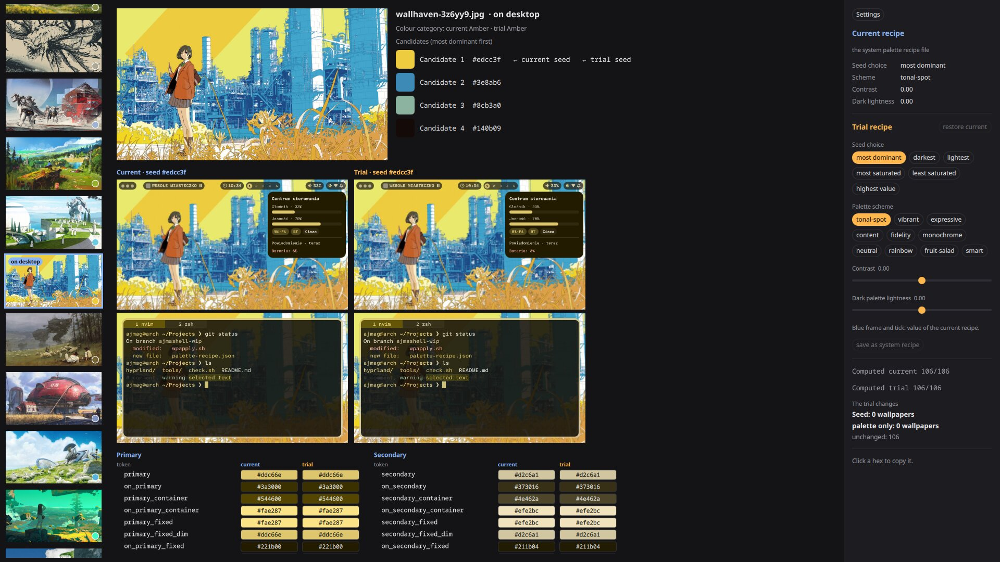

# Ajmashell Theme Center

A Quickshell window for tuning the colours of [Ajmashell](https://github.com/Wiecek-K/arch-hyprland-ajmag). For every
wallpaper of the Ajmashell carousel it shows the palette the system gives it under the palette recipe, and lets you
try another recipe before you save it as the system one.



It needs Ajmashell: it reads the carousel index, imports the palette recipe module from the Ajmashell install and runs
its scripts after a save. There is no stand-alone mode.

## Requirements

| What | Why | Arch Linux |
|---|---|---|
| Ajmashell (the `.config/quickshell/ajmashell` directory of the [dotfiles](https://github.com/Wiecek-K/arch-hyprland-ajmag)), on Hyprland | the palette recipe module, the wallpaper carousel and its index, the scripts that apply a palette | see its README |
| Quickshell (`qs`) | runs the window | `pacman -S quickshell` |
| matugen 4.2.0 | computes the candidates, the seed and the palette | `pacman -S matugen` |
| Python 3 | the helper behind the window | `pacman -S python` |

Another matugen version works, but may give other palettes from the same recipe: the window shows a warning
("tested with matugen 4.2.0, results may differ").

## Install

```sh
git clone https://github.com/Wiecek-K/ajmashell-theme-center.git ~/Projects/ajmashell-theme-center
cd ~/Projects/ajmashell-theme-center
./install.sh
```

`install.sh` changes nothing outside your home directory and never uses `sudo`. It:

1. checks `qs`, `matugen`, `python3` and the Ajmashell directory (the one from the settings, by default
   `~/.config/quickshell/ajmashell`). Each missing one prints a line with how to install it, for example
   `matugen not found: install matugen 4.2.0 (pacman -S matugen)`, and the script stops with exit code 1 before it
   installs anything,
2. links the clone as the Quickshell config `~/.config/quickshell/ajmashell-theme-center`,
3. installs the launcher entry `~/.local/share/applications/ajmashell-theme-center.desktop`.

The clone stays where you cloned it: the link points to it, so `git pull` updates the tool. After moving the clone,
run `./install.sh` again. `./install.sh --uninstall` removes the link and the launcher entry; the clone, the settings
and the cache stay.

The window rule that makes the window opaque (`theme-center-opaque`, class `ajmashell-theme-center`) comes with the
Ajmashell dotfiles (`~/.config/hypr/configs/rules.lua`); without it the window is as transparent as other windows.

## First start

Start "Ajmashell Theme Center" from the launcher, or `qs -n -c ajmashell-theme-center` (`-n`: a second start does not
open a second window).

The first start computes every wallpaper of the carousel with matugen, the selected one first, at most on half the
CPU cores. The results are cached, so later starts are instant. With no wallpapers in the window, open the Ajmashell
wallpaper carousel (Super + W) once: it builds the index the tool reads.

If something is missing (another Ajmashell directory, a Hyprland file elsewhere), a red line at the top of the right
panel names it and what it stops; open the Settings tab (see below).

## Terms

| Term | Meaning |
|---|---|
| palette recipe | the settings that turn a wallpaper into a palette: how the seed is chosen and the matugen palette flags |
| current recipe | the recipe Ajmashell uses now: its live palette recipe file, or its default recipe without that file |
| trial recipe | a copy of the current recipe that the controls change; nothing in the system changes until you save it |
| candidate | one of the colours matugen finds in the wallpaper's thumbnail, most dominant first |
| seed | the candidate the recipe picks; matugen builds the whole palette from it |
| colour category | the carousel's colour filter for a wallpaper (from the indexer), taken from the palette's `primary` |

## Using it

The window has tabs, in a bar at the top: **Palette** (the palette recipe, below), **Look** (the look of Ajmashell's
big popups, below) and, on the right edge, **Settings** (the paths). A dot after a tab's name ("Palette •") means its trial settings differ from the current ones and are not
saved yet. A tab keeps its state while you are in another one (trial recipe, selected wallpaper); closing the window
drops unsaved trial settings without asking.

- Keys: `Ctrl+1`, `Ctrl+2`… pick a tab of the bar, `Ctrl+Tab` / `Ctrl+Shift+Tab` the next / previous one, `Ctrl+,`
  opens Settings (again: back to the tab before it). In Palette, `↑` `↓` (and `←` `→`) change the wallpaper,
  `Home` / `End` the first / last one. A click on a swatch copies its hex.
- The controls (panel on the right) change the trial recipe: seed choice, scheme, contrast, dark palette lightness.
  Their lists and ranges come from `palette_recipe.options()`; the dark lightness has no lower limit in matugen (−∞),
  so its slider starts at −1. A request goes to the helper after 300 ms without changes (debounce). The trial is
  computed for the selected wallpaper only (and for each one you select later); "compute all wallpapers" computes the
  rest of the folder. "restore current" goes back to the current recipe. Strip: "seed" / "palette" = what
  the trial changes on that wallpaper; the second dot is the trial seed.
- For each recipe the middle shows a desktop mock-up (Bar and control centre) and a kitty mock-up, side by side, and
  the table of all palette tokens.
- **Look** sets the look of Ajmashell's seven big popups (Orbita, launcher, control centre, audio, calendar, media,
  Keybinds; one background for all): presets `basic`, `fancy`, `fancy2`, `still` and a builder (effects right under the
  presets: motion, lens flare, glass core, soft pills, blur under the popups; then background role and alpha 0.5–1). A click on a preset fills the builder; any change makes it
  "custom". The roles, the alpha range and the presets come from Ajmashell's `singletons/look/look-options.json`
  (through `look_settings.options()`), never copied here; a blue frame marks the current value. Two previews, one
  above the other, for the wallpaper selected in Palette: the current look on the current palette recipe and the trial look on
  the trial palette recipe, each with the Orbita and the control centre on a blurred piece of the wallpaper (a still
  frame: "motion" in the caption when the look moves).
- Under the builder, the **gradient** of the popups' background (one for every look: a preset keeps it): style (none; along a
  line: linear, two-colour, bands, mirror; from a point: centre glow, corner glow, conic, vignette,
  inverse vignette — a row per group),
  colours A and B (each a select of the same roles), strength, angle and the reaches A and B (what
  they mean depends on the style; a new style sets them to its defaults, a reach the style does not use and the angle
  of a style without a direction are greyed out). The styles and ranges come from `look-options.json` too. The previews draw the gradient
  with Ajmashell's own `look/GradientFill.qml`, loaded from the Ajmashell directory, so they match the popups.
- **Saved** (in Look under the presets, in Palette under the controls of the trial recipe): type a name and click
  "Save as" (or Enter) to keep the trial look or the trial recipe under that name; a click on a name loads it into the
  trial, "×" deletes it. A name that exists already, and a delete, ask with a second click on the same button
  ("overwrite?", "delete?"). Loading fills only the trial, like a preset: Ajmashell changes with "Save look" or "Save
  palette". A loaded look is the whole look (background, alpha, effects, gradient). While the trial still equals what
  was loaded or saved, the captions show its name instead of "custom", and its chip is filled. The two lists are apart:
  loading a look leaves the palette recipe as it is, and the other way round.

## Saving: what changes in your system

Each tab with trial settings has two buttons: its own save ("Save palette") and "Save all", the same in every tab.
"Save all" saves every tab with a dot (its label names them) after a confirmation that lists what each save does;
Esc or a click beside the box cancels. It saves the palette first, then the other tabs in the order of the bar, and
stops at the first error; the line under the button says what was saved and what not.

"Save palette" writes the trial recipe into Ajmashell's live palette recipe file,
`~/.local/state/ajmashell/palette-recipe.json` (through `palette_recipe.save()`: validated, atomic). Then, in the background,
it runs the carousel indexer (new seeds and colour categories, the thumbnails stay) and `wpapply.sh` on the wallpaper
on your desktop, so the desktop takes the new colours at once. The steps show under the button. The saved recipe
becomes the current one; every later wallpaper change uses it too.

The file is outside git, so trying a recipe leaves no trace in the dotfiles. Without it Ajmashell uses its default
recipe (`wallpaper/palette-recipe-default.json`); delete the file and apply a wallpaper again to go back to it. The tool
watches the file: a change made outside it (by hand, a delete) becomes the current recipe in the window. The tool
never writes into the Ajmashell directory.

"Save look" writes the trial look into Ajmashell's live look file, `~/.local/state/ajmashell/look.json` (through
`look_settings.save()`: validated, atomic). Ajmashell watches the file and changes its popups at once; the file is
outside git, so trying a look leaves no trace in the dotfiles. Delete the file to go back to Ajmashell's defaults.
New defaults or a new preset are a change in Ajmashell's `look-options.json`, never made by this tool.

"Save as" writes one file per name next to the live files: `~/.local/state/ajmashell/saved/look/<name>.json` and
`~/.local/state/ajmashell/saved/palette/<name>.json`, validated by the same modules (`look_settings.save()`,
`palette_recipe.save()`). They are read the way the live files are: a field missing in an older file (one saved before
a new gradient part, for example) takes the default, and a bad field shows a warning under the list. A name is one
file name: at most 64 characters, no `/` or `\`, not starting with a dot. Outside git, like the live files.

## Settings: the paths it needs

Every path comes from the Settings tab. The defaults are the paths of an Ajmashell install from the dotfiles, so
such an install needs no settings. Saved in `~/.config/ajmashell-theme-center/settings.json` (`$XDG_CONFIG_HOME` if
set), only the paths that differ from the default; no file = all defaults. A broken file gives the defaults and a
warning in the window. "apply" saves the file and restarts the helper (the window stays); "use default" empties a
field. While you type, each field shows "found" or "missing".

| Setting | Default | Without it |
|---|---|---|
| Ajmashell directory | `~/.config/quickshell/ajmashell` | needs `wallpaper/palette_recipe.py` (`load`, `save`, `seed_flags`, `palette_flags`, `fingerprint`, `options`) and `wallpaper/indexer.py` (`color_bucket`, the colour category; run after a save). Without them nothing is computed or saved. The Look tab needs `singletons/look/look_settings.py` (`load`, `save`, `options`, `DEFAULT_PATH`) and its `look-options.json`; without them only that tab is off. Without `look/GradientFill.qml` the previews draw no gradient |
| Carousel wallpaper index | `~/.cache/ajmashell/wallpapers/index.json` | no wallpapers: open the wallpaper carousel (Super + W) once to build it |
| Current wallpaper link | `~/.config/hypr/current_wallpaper` | no wallpaper marked "on desktop"; a save cannot apply the palette |
| kitty colour template | `~/.config/matugen/templates/kitty-colors.conf` | the kitty mock-up is off (lines `key {{ colors.TOKEN.default.hex }}`) |
| Hyprland looknfeel.lua | `~/.config/hypr/configs/looknfeel.lua` | the window border of the kitty mock-up is grey (`active_border`) |
| Hyprland rules.lua | `~/.config/hypr/configs/rules.lua` | the kitty mock-up is opaque (opacity of the kitty window rule) |
| wpapply.sh | `~/.config/hypr/scripts/wpapply.sh` | a save writes the recipe file but does not apply it to the desktop |

Each missing path shows in red at the top of the right panel with what it stops; the rest of the tool works. A file
that is there but not recognised (template without colour lines, `active_border` in another form) shows in red above
the mock-ups. The Ajmashell roles (Bar islands, control centre) are copied by hand into `Mockups.js`: after a change
of `Theme.qml`, fix them there.

The palette recipe file is no setting: the tool reads and saves the file the recipe module names
(`DEFAULT_PATH` in `palette_recipe.py`, today `~/.local/state/ajmashell/palette-recipe.json`), the same file `indexer.py`
and `wpapply.sh` read. Without it the window shows Ajmashell's default recipe; a save creates it.

`install.sh` reads the Ajmashell directory from the same settings file, so with Ajmashell elsewhere, write it there
first: `{"ajmashellDir": "/path/to/ajmashell"}` in `~/.config/ajmashell-theme-center/settings.json`.

The palette is computed as in the system: the seed from the thumbnail with the recipe's flags (as the indexer), the
palette from the seed through `matugen color hex` with the palette flags (as `wpapply.sh`), dark mode. For the wallpaper
on the desktop the result equals Ajmashell's `~/.local/state/ajmashell/colors.json` (checked 2026-10-20, 50 tokens).

## Layout

| File | Role |
|---|---|
| `shell.qml` | the frame: the tab list, the tab states, "Save all" and its order, the shortcuts; `//@ pragma AppId` gives the window class `ajmashell-theme-center` |
| `TabBar.qml`, `SaveAllButton.qml`, `SaveAllDialog.qml` | the tab bar, the "Save all" button every tab shows, its confirmation |
| `PaletteState.qml` | state of the Palette tab and the protocol with the helper (alive for the whole window, read by the other tabs) |
| `PaletteTab.qml` | the Palette tab: the parts below |
| `Strip.qml`, `WallpaperView.qml`, `TokenTable.qml`, `SidePanel.qml` (with `Chip.qml`, `TrialSlider.qml`) | strip on the left, preview with the candidates and the token table in the middle, panel on the right |
| `Previews.qml` (with `DesktopMock.qml`, `KittyMock.qml`) | desktop (Bar + control centre) and kitty mock-ups for the current and the trial recipe side by side; next to the table when the window is wide (table in two columns + at least 420 px), otherwise under the candidates |
| `LookState.qml` | state of the Look tab: the current and the trial look, presets, "Save look" (through the helper of `PaletteState`) |
| `SavedStore.qml`, `SavedSection.qml` | saved looks and recipes (one store per tab, the helper keeps the files): the names, "Save as", load, delete |
| `LookTab.qml`, `LookPresets.qml`, `GradientSection.qml`, `LookMock.qml` | the Look tab: previews of both looks, the presets and the builder, the gradient section, the Orbita and control centre mock-up (gradient drawn by Ajmashell's `look/GradientFill.qml`) |
| `Mockups.js` | the one place that maps tokens to parts of the mock-ups, with a note on where each comes from (roles of the Ajmashell `Theme.qml`; the look's background from the look; kitty and the border from the system's files) |
| `SettingsTab.qml`, `SettingsState.qml` | the Settings tab: a field per path, its default, "found" / "missing" |
| `helper/tuner.py` | the helper: real matugen, the recipe module, the look module and the colour categories from the Ajmashell install (imported by path, not copied), the matugen version check |
| `helper/saved.py` | saved settings: the folder next to a live file, the name rules, the list |
| `helper/settings.py` | the paths: defaults (the one place they are written), `settings.json`, found / missing |
| `install.sh` | install and uninstall, see above |
| `ajmashell-theme-center.desktop` | the launcher entry `install.sh` installs |
| `tests/` | helper tests, `tests/run.sh` |
| `LICENSE`, `SOURCES.md` | the license (AGPL-3.0-or-later) and where the code and ideas come from |
| `docs/screenshot.jpg` | the screenshot at the top of this README |

The protocol (JSON, one message per line) is described in the header of `helper/tuner.py`.
Result cache: `~/.cache/ajmashell-theme-center/results` (`$XDG_CACHE_HOME` if set) (key: wallpaper path, mtime, size,
recipe fingerprint); safe to delete at any time. Delete it after a matugen update (the fingerprint does not cover the
matugen version).

The texts of the desktop mock-up (control centre, volume, …) copy the real Ajmashell, whose interface is Polish, so
they stay Polish. Everything else in the window is English.

## Tests

`tests/run.sh` runs every helper test (Python standard library, `unittest`):

- `tests/test_settings.py`: the settings: defaults, own paths, a broken file or value, atomic save, found / missing.
- `tests/test_helper.py`: the helper's protocol, run as the window runs it: the palette recipe file named by the
  recipe module, two recipes in one request validated by the recipe module, the answers to `check` and `settings` (the
  helper restarts in the same process), missing paths as messages, a save with its steps, the default recipe without the live file and `readRecipe`, the matugen version warning, the look in `ready` (with its gradient and the path of `GradientFill.qml`) and `saveLook`; saved settings (`saveAs`, `loadSaved`, `deleteSaved`: a look and a
  recipe under a name after a restart, overwrite only when asked, a bad look or name refused, the list without files
  no name gives, an older file read leniently, a delete).
  Everything runs in a temporary directory with copies of the real `palette_recipe.py` and `look_settings.py` (from `$AJMASHELL_DIR` or
  `~/.config/quickshell/ajmashell`; the tests skip without it), stand-ins for `indexer.py` and `wpapply.sh`, and a
  stand-in `matugen` that only answers `--version`; no palette is computed. A helper that does not report its
  settings stops the test before any message, so a test never saves into the real recipe file.

The QML window and `install.sh` have no automated tests: checked by hand, the window with screenshots in full screen
and tiled on half the screen.

## License

AGPL-3.0-or-later, see [`LICENSE`](LICENSE). Sources and the projects the tool uses at run time: [`SOURCES.md`](SOURCES.md).
